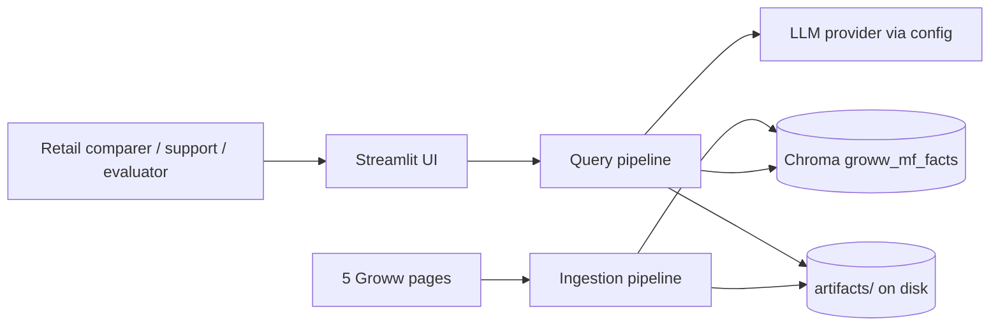
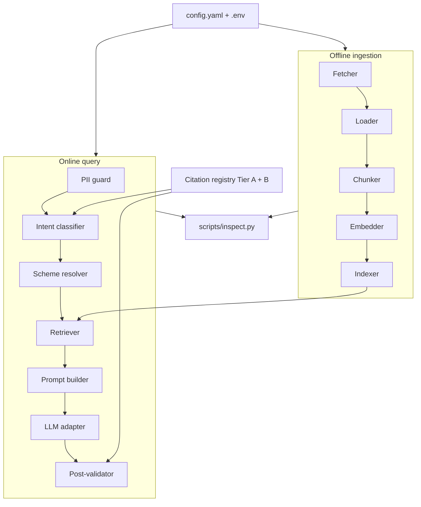
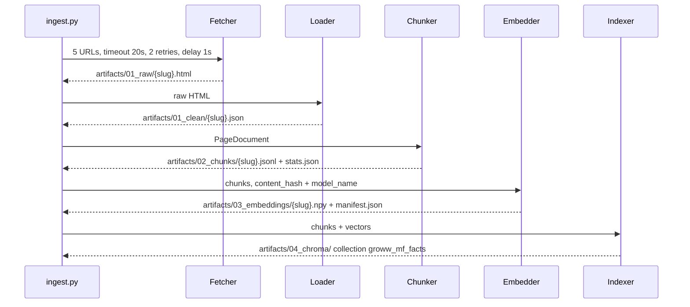
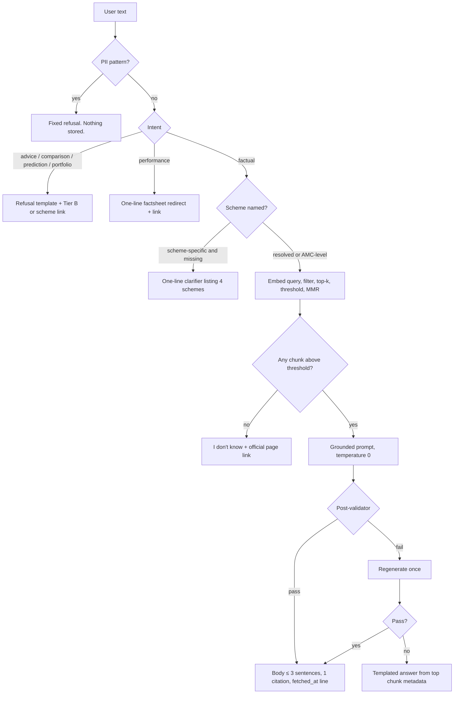

# Architecture — Groww MF Facts-Only FAQ Assistant

| Field | Value |
|---|---|
| Product | Groww Mutual Fund Facts-Only FAQ Assistant (RAG demo) |
| Aligns to | `Docs/PRD.md` v1.0 |
| Runtime | Local, CPU-only, Python 3.11, Windows / macOS / Linux |
| Status | Build architecture for the phase-gated prototype |

This document is the build view of the PRD. It fixes module boundaries, data contracts, and the two pipelines (offline index, online query) so each phase can be demoed on its own.

---

## 1. System context

The assistant answers a single factual question about one of four HDFC schemes (or the HDFC AMC overview) using a fixed corpus of five Groww pages. Every factual answer carries exactly one citation copied from chunk metadata. Advice, comparison, prediction, portfolio, performance, and PII inputs never reach the LLM as answerable questions.



External systems:

| System | Role | Constraint |
|---|---|---|
| Groww public pages | Corpus (Tier A), fetched once | Exactly the 5 URLs in PRD §5. Depth 1. 1 request/second. |
| Official Groww / HDFC MF / SEBI / AMFI URLs | Citation registry (Tier B) | Linked, never scraped |
| Sentence-Transformers | Query and document encoder | Same model for both; default `all-MiniLM-L6-v2` |
| ChromaDB | Persistent vector store | Local directory, cosine distance |
| Groq (default) or Gemini / OpenAI / Anthropic / Mistral | Grounded answer generation | Provider and model ID are config; API key lives in `.env` |

There is no user store, no auth, and no chat history. A query is stateless apart from the retrieval trace written for the demo.

---

## 2. Architectural principles

1. **Classify before retrieve.** Intent and PII decisions happen before any embedding call or vector lookup. Refusals do not spend a retrieval or an LLM generation.
2. **The citation is data, not text.** The URL in the answer is copied from the winning chunk’s `source_url`. The model is not allowed to invent a link.
3. **Stages are files.** Each phase writes a durable artifact set. Later phases read earlier artifacts and can be rebuilt without re-fetching.
4. **Config is the swap point.** Embedding model, vector store, and LLM provider change through `config/config.yaml` and `.env`. Call sites depend on interfaces, not on a vendor SDK.
5. **Fail loud on an empty load.** A page that yields no sections is a failed ingest, recorded in the phase report, with raw HTML kept for audit.

---

## 3. Logical architecture



### 3.1 Component responsibilities

| Component | Owns | Does not own |
|---|---|---|
| **Fetcher** | HTTP GET of the 5 URLs, retries, politeness delay, raw HTML snapshots | Parsing, link following |
| **Loader** | Clean text, section tree, key-value extraction, content hash | Chunk sizing |
| **Chunker** | `section`, `fact`, and `table_row` chunks plus metadata | Embeddings |
| **Embedder** | Batched, normalized vectors and the embedding manifest | Index storage |
| **Indexer** | Idempotent upsert into one Chroma collection | Query-time filtering policy |
| **PII guard** | Block PAN, Aadhaar, account numbers, OTP, email, phone before any log or artifact | Answering the question |
| **Intent classifier** | `FACTUAL` vs refusal classes, before retrieval | Free-text answers |
| **Scheme resolver** | Alias map to scheme slug, or a one-line clarifying question | Ranking funds |
| **Retriever** | Same-encoder assertion, top-k, score threshold, optional MMR, metadata filter, retrieval trace | Generation |
| **LLM adapter** | One chat call at temperature 0, provider selected by config | Choosing the citation URL |
| **Post-validator** | Sentence count, single allowlisted URL, advice-verb check, verbatim-number check; one regenerate, then a template | A second retrieval |
| **UI** | One screen, chips, disclaimer, citation render, collapsible retrieval panel | Business rules (it calls the query pipeline) |
| **Inspector** | Read any stage artifact by chunk id or query id | Mutating the index |

---

## 4. Repository layout

```
config/config.yaml          # all non-secret knobs (PRD §8)
.env                        # LLM_PROVIDER, GROQ_API_KEY, GROQ_MODEL
src/groww_faq/
  config.py                 # pydantic-settings: yaml defaults, env overrides
  models.py                 # PageDocument, Chunk, RetrievalTrace, Answer
  ingestion/
    fetch.py
    load.py
    chunk.py
    embed.py
    index.py
  query/
    pii.py
    intent.py
    scheme.py
    retrieve.py
    prompt.py
    validate.py
    pipeline.py             # online orchestrator
  llm/
    base.py                 # ChatClient protocol
    groq.py
    gemini.py
    openai_client.py
    anthropic_client.py
    mistral_client.py
    factory.py              # provider string → adapter
  registry.py               # Tier A corpus URLs + Tier B citation-only URLs
ui/app.py                   # Streamlit
scripts/ingest.py           # P1→P4 orchestrator: rebuild index from raw HTML or from scratch
scripts/export_onnx.py      # build api/data: ONNX MiniLM + serverless chunk index (gated)
scripts/inspect.py          # FR-9 CLI
api/                        # Vercel serverless edition (see §8.1)
  ask.py                    #   POST /api/ask — mirrors query/pipeline.py
  requirements.txt          #   function deps only (onnxruntime, numpy, tokenizers, httpx, pydantic)
  data/                     #   minilm_int8.onnx, tokenizer.json, chunks.json, vectors.npy, index_manifest.json
public/index.html           # static Groww-styled frontend (POSTs to /api/ask)
vercel.json                 # outputDirectory public, function config, excludeFiles
artifacts/                  # gitignored generated state
Docs/sources.md
Docs/sources.csv
README.md
```

`Docs/PRD.md` and `Docs/architecture.md` stay the product documents. Runtime paths in code follow the PRD (`config/`, `artifacts/`, `docs/`); on Windows `docs/` and `Docs/` are the same case-insensitive directory, so the source registry lives in `Docs/`.

---

## 5. Offline pipeline

One command (`scripts/ingest.py`) runs P1–P4. Each stage is also callable alone so a phase demo does not require the UI.



### 5.1 Fetch (P1)

- Client: `httpx` (or `requests`), browser-like User-Agent from config.
- Policy: `timeout_s=20`, `retries=2` with backoff, `delay_s=1.0`, `respect_robots=true`.
- Allowlist: the five Tier A URLs only. Redirects that leave this set are rejected and recorded.
- Output per page: `artifacts/01_raw/{slug}.html`.

If the body is empty or clearly a JS shell (no fund spec text), the fetcher records the failure. A Playwright fetch of **the same URL** is the documented fallback (PRD risk: client-side rendering). It still does not follow links.

### 5.2 Load (P1)

- Primary extractor: `trafilatura` for cleaned main text.
- Structure: BeautifulSoup with `lxml`, used for the section tree and the spec key-value block.
- Strip: nav, footer, cookie banners, app-download prompts, repeated disclaimers, ad slots.
- Keep structure. Fund spec blocks become key-value pairs, not prose.

`PageDocument` (written to `artifacts/01_clean/{slug}.json`):

| Field | Meaning |
|---|---|
| `source_url` | The fetched Tier A URL |
| `page_title` | Parsed title |
| `page_type` | `amc` or `scheme` |
| `slug` | Stable file id, e.g. `hdfc-elss-tax-saver-fund-direct-plan-growth` |
| `amc` | `HDFC Mutual Fund` |
| `scheme` | Scheme display name, empty on the AMC page |
| `plan` | `Direct Growth` where the page is a direct plan |
| `fetched_at` | UTC ISO-8601 |
| `content_hash` | SHA-256 of cleaned JSON body |
| `sections[]` | `{heading, level, text_blocks[], key_value_pairs[]}` |

P1 exit gate: a parse report lists, per scheme, the seven required facts (expense ratio, exit load, minimum SIP, minimum lumpsum, lock-in where applicable, riskometer, benchmark) as found or as an explicit gap. A zero-section page fails the gate.

### 5.3 Chunk (P2)

Strategy key: `chunking.strategy = layout_hybrid`.

| `chunk_type` | Cut rule | Target size |
|---|---|---|
| `section` | One chunk per H2/H3; recursive split at `max_tokens` (400) with `overlap_tokens` (60) | 150–400 tokens |
| `fact` | One chunk per key-value pair | 15–40 tokens |
| `table_row` | One chunk per row, header prepended | 20–50 tokens |

Fact template, so a lone chunk still names its scheme:

```
{AMC} | {Scheme} | {Plan} | {fact_key}: {fact_value}
```

Drop chunks under `min_tokens` (10) or over 800 tokens. Deduplicate by content hash.

Chunk metadata (stored on the chunk and later in Chroma):

`chunk_id, amc, scheme, scheme_slug, plan, page_type, chunk_type, section, fact_key, source_url, fetched_at, content_hash`

`chunk_id` is deterministic: hash of `(source_url, chunk_type, section, fact_key, content_hash)` so the same config rebuilds the same ids.

Outputs: `artifacts/02_chunks/{slug}.jsonl`, `artifacts/02_chunks/stats.json` (counts by type, token histogram).

P2 exit gate: fact chunks exist for expense ratio, exit load, min SIP, lock-in, riskometer, and benchmark wherever P1 marked the fact present.

### 5.4 Embed (P3)

- Model from config, default `sentence-transformers/all-MiniLM-L6-v2`, 384 dimensions, `normalize_embeddings=true`.
- `device` default `cpu`, `batch_size` 32.
- Cache key: `content_hash + model_name`. Unchanged chunks are not re-encoded. A model-name change misses the cache on purpose.
- Outputs: `artifacts/03_embeddings/{slug}.npy`, `artifacts/03_embeddings/manifest.json`.

Manifest fields: `model_name`, `dim`, `normalize`, `count`, `checksum` (hash of chunk ids in order + vector bytes). Retrieval refuses to run when the live encoder’s model name or dim disagrees with the manifest.

### 5.5 Index (P4)

- Persistent Chroma client at `vectorstore.persist_dir` (`artifacts/04_chroma/`).
- One collection: `groww_mf_facts`. Distance: `cosine`.
- Upsert id = `chunk_id`. Document field = chunk text. Metadata = the chunk metadata fields (scalars only; Chroma rejects nested objects).
- Rebuild path: delete and upsert from `02_chunks` plus `03_embeddings` with no network. A full re-embed is a separate flag when the model changes.

P4 exit gate: a scripted sample query for a named scheme returns a chunk whose `scheme_slug` matches.

---

## 6. Online pipeline

`query/pipeline.py` is the only entry the UI calls. It returns a typed `Answer` and always writes `artifacts/05_retrieval/{query_id}.json` except when the PII guard blocks the turn (that turn is not persisted).



### 6.1 PII guard

Runs first, in-process, on the raw string. Patterns cover PAN, Aadhaar, account numbers, OTP, email, and phone. On match the pipeline returns the fixed line *"I don't need or store personal details."* and returns before logging, embedding, or artifact writes. The raw string is not copied into the retrieval trace.

### 6.2 Intent classifier

A small rules-first classifier (keyword and pattern lists for advice verbs, comparison cues, prediction cues, portfolio cues, performance cues). It runs before retrieval, as required by PRD FR-5.

| Class | Next step |
|---|---|
| `FACTUAL` | Scheme resolution, then retrieval |
| `ADVICE`, `OPINION`, `COMPARISON`, `PREDICTION`, `PORTFOLIO` | Refusal template, no retrieval, no LLM |
| `PERFORMANCE` | No arithmetic. One-line redirect to the factsheet URL from the registry, with that URL as the single citation |
| `PII` | Already handled by the guard; the classifier is a second net |

Refusal shape (PRD FR-7): two sentences plus one link. Comparison refusals may name both scheme pages in the sentence and still emit **one** primary link, with the second page available in the retrieval panel only if a link was actually resolved from the registry. The rendered answer still shows one citation URL so the answer contract stays uniform.

The educational link comes from the citation registry (the scheme page when a scheme was named, otherwise the AMC overview or the relevant Tier B help/factsheet URL). It is never produced by the LLM.

### 6.3 Scheme resolver

Alias map lives next to config, for example:

| Alias cues | `scheme_slug` |
|---|---|
| elss, tax saver | `hdfc-elss-tax-saver-fund-direct-plan-growth` |
| flexi, flexi cap | `hdfc-equity-fund-direct-growth` |
| large cap | `hdfc-large-cap-fund-direct-growth` |
| mid cap | `hdfc-mid-cap-fund-direct-growth` |
| hdfc amc, hdfc mutual fund | AMC page slug, `page_type=amc` |

When the question is scheme-specific (expense ratio, exit load, SIP, riskometer, benchmark) and no scheme resolves, the pipeline returns one clarifying question that lists the four schemes. That turn does not call the LLM.

### 6.4 Retrieval

1. Load `manifest.json` and assert the encoder model name and dimension match.
2. Embed the query with that encoder.
3. If a scheme resolved, apply a Chroma `where` filter on `scheme_slug` (and `page_type` when the question is AMC-level).
4. Request `top_k` (default 6) by cosine distance.
5. Drop hits below `score_threshold` (default 0.25). Chroma returns distance; the retriever converts cosine distance to a similarity score before the threshold so the config value means similarity.
6. If `use_mmr` is true, diversify with `mmr_lambda` (default 0.5) so six near-copies of the same fact do not fill the context.
7. Write the trace: original query, any rewritten query, filters, chunk ids, scores, text, and the chosen citation URL.

`query_id` is a timestamp plus a short hash of the query. The trace is the source for the UI “Show retrieval” panel and for `scripts/inspect.py`.

### 6.5 Generation

`llm/factory.py` reads `llm.provider` and returns a `ChatClient`:

```
complete(system: str, user: str, temperature: float, max_tokens: int) -> str
```

Default provider is Groq’s OpenAI-compatible chat endpoint. `GROQ_MODEL` in `.env` overrides `llm.model`. Startup calls a lightweight model check and exits with a clear error when the id is not on the provider’s list (PRD open question: pin the real Groq id; `qwen/qwen3.8-27b` is not a valid id).

Other providers (Gemini, OpenAI, Anthropic, Mistral) implement the same `ChatClient`. Selecting one is a config change. The query pipeline does not import a provider SDK directly.

Prompt contract:

- System prompt: answer only from the supplied context; no external knowledge; no arithmetic; no comparisons; no advice; if the fact is absent, say so in one sentence.
- User prompt: the question plus the retrieved chunks, each labeled with `chunk_id` and `source_url`.
- `temperature=0.0`, `max_tokens≈220`.

The model is instructed to cite the fact in prose and **not** to emit a URL. The pipeline appends the citation itself.

### 6.6 Post-validator and answer contract

The validator checks the model text before anything is shown:

| Check | Pass condition | On failure |
|---|---|---|
| Length | ≤ `max_answer_sentences` (3) | Regenerate once |
| URLs in model text | Zero URLs in the model output | Strip and regenerate once |
| Advice vocabulary | None of: should, recommend, better, avoid, buy, sell, hold | Regenerate once |
| Numbers | Every number in the answer appears verbatim in the context | Regenerate once |

After one failed regenerate, the pipeline emits a template built from the top chunk: the fact line, the chunk’s `source_url`, and `Last updated from sources: {fetched_at}`. The template path still satisfies the answer contract.

Rendered answer, in order:

1. Body, at most three sentences.
2. Exactly one markdown link, `source_url` of the selected chunk (or the registry URL for refusals and performance redirects).
3. `Last updated from sources: {fetched_at}` using the chunk or page timestamp. Refusal turns use the registry entry’s recorded date when no chunk was retrieved.

Out-of-corpus factual misses (retrieval below threshold) use an explicit “I don’t know” sentence plus the official page link. They do not call the model to guess.

### 6.7 Query-time artifact

`artifacts/05_retrieval/{query_id}.json` stores the trace and the final answer payload (body, citation URL, `fetched_at`, path taken: `answer | refusal | redirect | clarify | miss | template`). PII-blocked turns are absent from this folder.

`artifacts/run_manifest.json` is written at ingest time and refreshed when the app starts: config snapshot with secrets redacted, embedding manifest checksum, collection count, and timestamps. This is the sixth artifact set alongside stages 01–05.

---

## 7. Citation registry

`src/groww_faq/registry.py` is the allowlist behind both scraping and citations.

| Tier | Count | Used for |
|---|---|---|
| A — corpus | 5 | Fetch, chunk, embed, index. These are the only scrape targets. |
| B — citation only | 10 | Factsheet redirects, statement-download help, SEBI / AMFI investor pages, refusal links. Never fetched. |

Total registry size is 15 URLs (5 Tier A + 10 Tier B), matching deliverable D2 (`Docs/sources.md` and `Docs/sources.csv`). Domains are limited to Groww, HDFC Mutual Fund, SEBI, and AMFI. The post-validator and the UI both check the emitted URL against this registry, which is what makes citation validity measurable at 100%.

---

## 8. UI

One Streamlit screen (`ui/app.py`):

- Welcome line.
- Three example chips that submit a factual question through the same pipeline as typed input.
- Input box. The PII guard runs on submit inside the pipeline; the UI also disables send when the guard matches, so the raw value is not placed in `st.session_state`.
- Answer block: body, one link (new tab), last-updated line.
- Collapsible “Show retrieval” bound to the current `query_id` trace (chunk ids, scores, section, fact key).
- Persistent footer, exact string: `Facts-only. No investment advice.`

The UI holds no retrieval or prompt logic. Session state keeps only the current turn’s rendered answer so a refresh does not invent history.

### 8.1 Vercel edition (serverless)

The Streamlit app needs torch, sentence-transformers and a persistent Chroma directory, none of which fit a serverless function (bundle size, read-only filesystem, no background sockets). The **Vercel edition** runs the same facts-only pipeline as a static page plus one Python function:

| Piece | File | Notes |
|---|---|---|
| Frontend | `public/index.html` | Groww-styled static page; `POST /api/ask`. Same answer contract (body, one citation, last-updated, retrieval details). |
| Function | `api/ask.py` | File-based Vercel function (`class handler(BaseHTTPRequestHandler)`). One route: `POST /api/ask` (`GET` returns a health payload without any question data). |
| Guardrails | `src/groww_faq` imports | PII patterns, intent regexes, scheme aliases, system prompt, validator and the citation registry are **imported from the same package as the app** — one source of truth, not a fork. `config.yaml` is not read; its retrieval/LLM knobs are mirrored as module constants next to the values they mirror. |
| Retrieval | `api/data` index | `MiniLMOnnx` (ONNX int8 all-MiniLM-L6-v2, ~22 MB) embeds **queries only**; `vectors.npy` stores the **torch document vectors — bit-identical to the rows in the Chroma collection** — so document-side ranking matches the app exactly and the single approximation left is the query embedding. `chunks.json` + `vectors.npy` replace Chroma; cosine search, top-6, threshold 0.25, MMR λ 0.5 mirror `query/retrieve.py` verbatim. |
| LLM | Groq over `httpx` | Same request shape as `llm/factory.py`: temperature 0, 220 max tokens, one retry on timeout/5xx/429, then the cited template fallback. Model id from the `GROQ_MODEL` env var (`openai/gpt-oss-120b`). |

Deliberate differences from the app:

- **No trace files.** The Vercel filesystem is read-only; the retrieval trace (query id, intent, path, filter, hits) is returned inside the JSON response instead — every stage stays inspectable (FR-9) in the browser's network tab and the UI's "Show retrieval details" panel.
- **Secrets.** `GROQ_API_KEY` / `GROQ_MODEL` are Vercel project environment variables, never repo files. A missing key is an LLM failure: the cited template fallback answers, the process never crashes.
- **PII turns** return the minimal `{body, path}` payload — no question echo, no trace keys.
- **Dependency isolation.** `api/requirements.txt` (onnxruntime, numpy, tokenizers, httpx, pydantic) is the manifest nearest the entrypoint, so Vercel installs only those; the root `requirements.txt` with torch/streamlit/chromadb is never part of the function bundle. `vercel.json` excludes `artifacts/`, `tests/`, `Docs/`, `scripts/`, `ui/`, `config/` and `.env` from the bundle.

The index is rebuilt by `scripts/export_onnx.py`, which exports MiniLM to ONNX, quantizes to int8, embeds all 468 chunks with the same `MiniLMOnnx` class the function uses, and **gates the write** on cosine agreement with the torch reference vectors (mean ≥ 0.985, worst ≥ 0.90; measured 0.9942 / 0.9903). Equivalence against the app pipeline was verified before deployment: guardrail paths (refusal / redirect / miss / clarify / PII) 100 % identical; factual answers verbatim-identical when both LLM calls returned; retrieved top-3 chunk ids identical on all 12 probe questions (tail hits can swap at near-tied scores, ±0.01, which never changes the citation or the answer).

---

## 9. Configuration and secrets

`config/config.py` loads `config/config.yaml`, then applies environment overrides via pydantic-settings. Secrets are read only from `.env` (`GROQ_API_KEY` and the equivalent key for a fallback provider). The run manifest stores the provider name and model id, and replaces any key with `"set"` or `"missing"`.

Startup checks:

- The five Tier A URLs are present and unique.
- Embedding model name is non-empty.
- When the app is serving queries, `manifest.json` exists and matches the configured model.
- The configured LLM id is accepted by the provider, or the process exits with the id and the provider name in the error.

---

## 10. Cross-cutting behavior

| Concern | Mechanism |
|---|---|
| Latency (p95 < 6 s, retrieval < 300 ms) | Tiny corpus, local Chroma, one LLM call, refusals skip both retrieval and the LLM. |
| Reproducibility | Deterministic `chunk_id`; ingest rebuilds from `01_raw` without the network. |
| Privacy | PII guard before logs and artifacts; Chroma metadata has no user text; traces store the query only after the guard passes. |
| Compliance | Fetch allowlist of 5 URLs; citation allowlist of the registry; 1 req/s; identifying User-Agent. |
| Cost | CPU re-index under a minute; generation capped near 220 output tokens. |
| Inspectability | `python scripts/inspect.py stage <01_raw\|01_clean\|02_chunks\|03_embeddings\|04_chroma\|05_retrieval> --id <id>` prints that stage. |
| Provider swap | `llm.provider` plus the matching `*_API_KEY`. Embedding swap changes `embedding.model_name` and requires re-embed. Vector-store swap is the `vectorstore.provider` seam; v1 implements Chroma only, and the retriever talks to a `VectorStore` protocol so a second provider can be added without touching the pipeline. |

Logging goes to stderr at INFO. Log records include `query_id`, stage, and latency. They do not include document text from a PII-blocked turn, and they do not include API keys.

---

## 11. Failure handling

| Failure | Behavior |
|---|---|
| HTTP error or timeout on a corpus URL | Retry twice with backoff. Then mark that slug failed in the P1 report and continue the other pages. Ingest’s exit code is non-zero if any of the five fail. |
| Load yields no sections | Fail P1 for that slug. Keep the HTML snapshot. |
| Required fact missing on the page | Record a gap. Do not invent a chunk. Query-time miss path answers “I don’t know” with the page link. |
| Embedding model download unavailable | Fail at P3 with the model name. |
| Manifest / encoder mismatch | Refuse to answer; tell the operator to re-run ingest. |
| Chroma persist directory missing | Query pipeline reports that the index is not built. |
| LLM timeout or 5xx | One retry, then the template fallback from the top chunk when retrieval succeeded. |
| Invalid model id | Exit at startup. |
| Validator rejects twice | Template fallback. The user still sees one cited fact or an honest miss. |

---

## 12. Phase mapping

| Phase | Code entry | Reads | Writes | Demo without UI |
|---|---|---|---|---|
| P1 Fetch + Load | `ingestion.fetch` + `ingestion.load` | 5 URLs | `01_raw`, `01_clean`, parse report | Open a clean JSON and show key-value pairs |
| P2 Chunk | `ingestion.chunk` | `01_clean` | `02_chunks` | Show a fact chunk and a section chunk for the same page |
| P3 Embed | `ingestion.embed` | `02_chunks` | `03_embeddings` | Print manifest dim, count, checksum |
| P4 Index | `ingestion.index` | `02_chunks`, `03_embeddings` | `04_chroma` | Sample query filtered by scheme slug |
| P5 Query + UI | `query.pipeline` + `ui/app.py` | Index, manifest, registry | `05_retrieval`, `run_manifest.json` | App: 5 factual answers, 3 refusals, retrieval panel |

P5 depends on P4 artifacts. It does not re-fetch pages.

---

## 13. Evaluation hooks

Accuracy and refusal metrics from PRD §14 are measured offline against two files the team supplies (open question 5 in the PRD):

- `eval/gold.jsonl` — 20 factual questions with expected fact substring and expected Tier A URL.
- `eval/adversarial.jsonl` — 10 advice, comparison, prediction, portfolio, performance, and PII prompts with the expected path (`refusal`, `redirect`, or `pii_block`).

A small `scripts/eval.py` calls the same `query.pipeline` and scores accuracy, citation validity (URL in the registry and matching the expected page when the gold row names one), refusal precision, sentence-count compliance, and a scan that PII strings from the adversarial file do not appear under `artifacts/`. The eval script is a measurement tool; it is not on the request path.

---

## 14. Decisions recorded here

| Topic | Decision |
|---|---|
| App shape | Streamlit for v1. FastAPI + one HTML page remains a later swap behind the same pipeline. |
| Intent | Rules-first, before retrieval. An LLM classifier would spend a call on questions we must refuse. |
| Citation | Selected in code from chunk metadata or the registry. |
| Vector score | Config threshold is cosine **similarity**. The retriever converts Chroma cosine distance. |
| Model id | Config value, validated at startup against the provider. |
| Statement-download answers | Until PRD open question 2 is closed, the pipeline may answer only from Tier A text. If that text is absent, it returns the miss path with the Tier B help URL as the single link, and does not scrape that URL. |
| Serverless retrieval | The Vercel function embeds queries with int8 ONNX MiniLM but stores the **torch document vectors**, so only the query side is approximate (gated ≥ 0.985 mean cosine); Chroma itself stays the app's index. |
| Serverless guardrails | `api/ask.py` imports the guardrail modules from `src/groww_faq` instead of copying them; only the retrieval mechanics (numpy cosine + MMR) are mirrored, with the mirrored constants sitting next to the config values they reproduce. |
